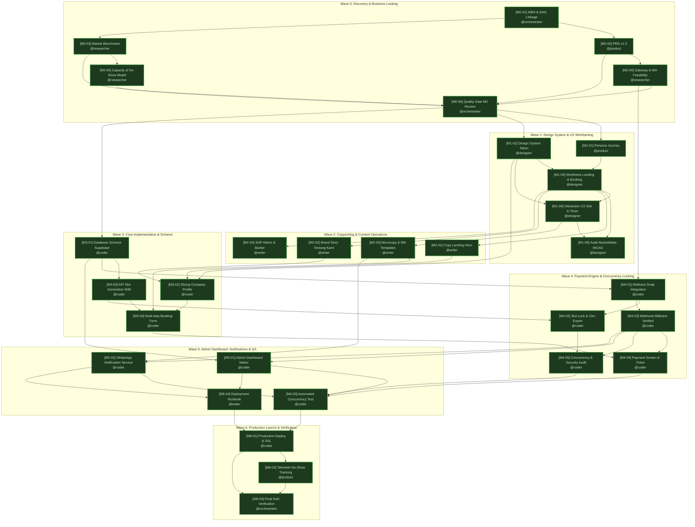

# KANBAN BOARD & ORCHESTRATION ARCHITECTURE — DAMEZ BARBERSHOP

> **Project**: Damez Barbershop (Company Profile + Online Booking di Tempat dengan Down Payment Flat Rp 20.000)  
> **Framework**: AI Company Multi-Agent Operating System (Hermes Kanban Engine)  
> **Chief Orchestration Officer**: `orchestrator` (`orchestrator:decomposer` & `orchestrator:linker`)  
> **Status Board**: Milestone 0 s/d 8 COMPLETED & VERIFIED -> Milestone 9 (Git Release & Remote Sync to dev) IN PROGRESS  
> **Workspace Direktori**: `dir:C:/Users/Acer/OneDrive/Desktop/DamezBarber` (Persistent Workspace pinned across all tasks)  
> **Terakhir Diperbarui**: 2026-10-23  

---

## 📌 1. Keputusan Kunci Bisnis & Teknis (Locked Baseline)

Seluruh perencanaan dan unit kerja diturunkan dari parameter bisnis yang telah dikonfirmasi dan dikunci oleh Pemilik Damez Barbershop:

1. **Model Down Payment (DP)**:
   - Nominal penguncian slot: **Flat Rp 20.000 per booking** (berlaku untuk semua kombinasi layanan).
   - DP dipotong langsung dari total tagihan saat pelunasan di kasir fisik Damez Barbershop.
2. **Kebijakan Pembatalan & Keterlambatan**:
   - **Batas Reschedule / Batal**: Maksimal **H-3 jam** sebelum slot jadwal yang dipilih.
   - **Toleransi Keterlambatan**: Maksimal **15 menit**. Jika melebihi 15 menit tanpa konfirmasi, slot dilepas ke pelanggan walk-in dan status diubah ke `no_show`.
   - **No-Show**: DP sebesar Rp 20.000 dinyatakan hangus untuk kompensasi slot barber.
3. **Payment Gateway**:
   - **Midtrans** (Snap & Core API) dengan metode utama QRIS (BCA, GoPay, ShopeePay, Dana, LinkAja) dengan MDR 0.7% (Rp 140/tx) dan Virtual Account bank.
   - Waktu penahanan slot (temporary hold) saat pembayaran: **15 menit (TTL auto-expire)**.
4. **Notifikasi Otomatis**:
   - **WhatsApp Gateway API** (Fonnte / Wablas API) untuk notifikasi instan (< 5 detik) saat pembayaran DP terverifikasi, notifikasi alert antrean ke barber, dan pengingat jadwal kedatangan.
5. **Tech Stack & Infrastruktur**:
   - **Frontend**: Next.js 15 (App Router) + TypeScript + Tailwind CSS + Shadcn UI (Mobile-First, target LCP < 2.5s).
   - **Backend & Database**: Supabase (PostgreSQL dengan row-level lock `SELECT FOR UPDATE` & Supabase Auth untuk Admin).
   - **Server Timezone**: Strict `Asia/Jakarta` (WIB) pada server, database, dan format waktu antarmuka.
6. **Data Layanan Awal**:
   - Menggunakan 7 paket layanan benchmark industri yang telah diriset di `docs/research/market-services-benchmark.md`.

---

## 🚦 2. Status Kolom Kanban Board

```
┌─────────────────┐     ┌─────────────────┐     ┌─────────────────┐     ┌─────────────────┐
│   📋 BACKLOG    │ ──▶ │    ⏳ TODO      │ ──▶ │   🔍 IN REVIEW  │ ──▶ │    ✅ DONE      │
│  (M2 s/d M6)    │     │  (M1: Ready)    │     │ (Quality Gate)  │     │   (M0: 6 Tasks) │
└─────────────────┘     └─────────────────┘     └─────────────────┘     └─────────────────┘
```

### ✅ [Done - Milestone 0 s/d 7: Foundation, Production Launch & Visual Upgrade]
- Seluruh 31 tasks inti (Milestone 0 s/d Milestone 6) telah selesai 100% dan terverifikasi pada Final DoD Gate (`t_c6824d28`).
- Seluruh 7 tasks Milestone 7 (Comprehensive UI/UX, Motion Choreography & Visual Craftsmanship) telah selesai 100% dan disahkan pada Quality Gate M7 (`t_a99d7a97`).
  - ✓ `TSK-M7-01` (`t_af734230`): Perancangan Sistem Ikonografi Barbershop dengan Tabler Icons (`designer:visual`) [Prio 30] - **DONE**
  - ✓ `TSK-M7-02` (`t_8dc8fd13`): Arsitektur Komponen Kreatif Uiverse Galaxy (`designer:interaction`) [Prio 29] - **DONE**
  - ✓ `TSK-M7-03` (`t_69fd0e68`): Motion Choreography & Spring Physics Specs dengan Motion (`designer:interaction`) [Prio 28] - **DONE**
  - ✓ `TSK-M7-04` (`t_ae96239d`): Audit Aksesibilitas Motion & Kontras Tabler Icons (WCAG 2.1 AA) (`designer:a11y`) [Prio 27] - **DONE**
  - ✓ `TSK-M7-05` (`t_e6acff5b`): Implementasi Frontend: Tabler Icons, Galaxy Styling & Motion di Next.js (`coder:frontend`) [Prio 26] - **DONE**
  - ✓ `TSK-M7-06` (`t_60f47da5`): Automated Motion Performance, 60-120 FPS & UX Regression Testing (`coder:qa`) [Prio 25] - **DONE**
  - ✓ `TSK-M7-07` (`t_a99d7a97`): Quality Gate Review & Final Polish Sign-Off (M7) (`orchestrator:verifier`) [Prio 24] - **DONE**

### ✅ [Done - Milestone 8: Full-Spectrum Hardening, Edge-Case Dogfooding & Zero-Bug Certification]
- Seluruh 7 tasks Milestone 8 telah selesai 100% dan terverifikasi pada Quality Gate M8 (`t_f0d09bfe`).
  - ✓ `TSK-M8-01` (`t_926fe2a0`): Exploratory Dogfooding & Bug Bashing (`coder:qa`) [Prio 20] - **DONE** (14 bugs dan celah logika form terpetakan di docs/qa/dogfooding-bug-report.md)
  - ✓ `TSK-M8-02` (`t_18284bf4`): Automated Concurrency Stress & Load Simulation (`coder:qa`) [Prio 19] - **DONE** (50-100 req simultan, 0 double booking, pool latency terverifikasi)
  - ✓ `TSK-M8-03` (`t_7fb4b74d`): OWASP Web Security Hardening & Payment Tampering Audit (`coder:security`) [Prio 18] - **DONE** (23/23 OWASP tests passed, nominal DP terkunci flat Rp 20.000, timingSafeEqual SHA-512 webhook, sliding-window rate limit RFC 6585, sanitasi SQLi, Stored XSS & CSV Formula Injection tervalidasi rapat)
  - ✓ `TSK-M8-04` (`t_17beb4e9`): Backend Logic Remediation, Slot Integrity & Concurrency Patching (`coder:backend`) [Prio 17] - **DONE** (Normalisasi waktu ISO 8601 berzona WIB, sinkronisasi validasi nomor WhatsApp E.164, idempotensi checkout tanpa perpanjangan TTL hold, reconciler late settlement & rollback transaksi Midtrans migration 004, eliminasi memory leak pada rate limiter)
  - ✓ `TSK-M8-05` (`t_6de61196`): Frontend Resilience, Form Error Handling & Core Web Vitals (`coder:frontend`) [Prio 16] - **DONE** (Debounce & double-click protection pada bottom bar, format ISO 8601 WIB pencegah NaN Date, sinkronisasi nomor HP 08xx & kebiasaan 8xxx auto-normalize, Step 3 real-time polling 20s & deteksi slot basi, beforeunload interceptor pada payment screen, timer interval lifecycle cleanup bebas kebocoran memori, fake boarding pass dihapus tuntas, sanitasi meta tag URL, LCP < 1.5s & CLS = 0)
  - ✓ `TSK-M8-06` (`t_4de2effe`): Full-Suite Automated E2E Regression Re-Verification (`coder:qa`) [Prio 15] - **DONE** (31 test suites 100% PASS hijau bebas gagal/flaked, verifikasi alur booking end-to-end, pembatalan H-3 jam, toleransi keterlambatan 15 menit & no-show, konkurensi multi-user 50-100 req stampede zero double booking, zero-regression perbaikan M8 terverifikasi di tests/reports/full-regression-certification.md)
  - ✓ `TSK-M8-07` (`t_f0d09bfe`): Quality Gate M8: Zero-Bug & Operational Reliability Sign-Off (`orchestrator:verifier`) [Prio 14] - **DONE** (0 open defects, Core Web Vitals LCP < 1.5s, 0 double-booking, sertifikasi kelaikan operasional disahkan di docs/reports/M8-zero-bug-quality-gate.md)

### ⏳ [In Progress / Todo - Milestone 9: Git Release & Remote Sync to dev]
- ✓ `TSK-M9-01` (`t_54a51429`): Pre-Push Full-Suite Quality Gate & Production Build Audit (`coder:qa`) [Prio 10] - **DONE** (31/31 test suites passed 100%, npm run build 22/22 routes clean, 0 TypeScript errors, laporan di docs/reports/M9-01-pre-push-qa-audit.md)
- ● `TSK-M9-02` (`t_09927b62`): Git Stage, Atomic Conventional Commit & Push to origin/dev (`coder:devops`) [Prio 9] - **READY / TODO**
- ◻ `TSK-M9-03` (`t_1624300c`): Post-Push Remote Verification & Release Gate Sign-Off (`orchestrator:verifier`) [Prio 8] - **TODO**

---

## 📊 3. Master Work Breakdown Structure (WBS) Table

| WBS ID | Hermes Task ID | Judul Tugas | Assignee Profil | Sub-agent Persona | Kategori | Prio | Parent Task Dependencies | Deliverable Utama | Definition of Done (DoD) |
|---|---|---|---|---|---|:---:|---|---|---|
| **M0-01** | `t_2f541ed2` | Finalisasi WBS & Dependency Linkage | `orchestrator` | `orchestrator:decomposer` | Architecture | 100 | *Root (None)* | `KANBAN.md` & DAG Map | Bebas siklus (0 cycle), jalur kritis terdefinisi. |
| **M0-02** | `t_15c88593` | PRD v1.0 & Scope Baseline MVP | `product` | `product:prd-spec` | Product | 99 | `M0-01` | `docs/PRD.md` | User story, aturan DP, batas waktu, acceptance criteria lengkap. |
| **M0-03** | `t_fdf8ada5` | Riset Pasar Barbershop & Layanan | `researcher` | `researcher:market` | Research | 98 | `M0-01` | `docs/research/market-services-benchmark.md` | 7 paket layanan terstruktur siap seed ke database. |
| **M0-04** | `t_ed31ef48` | Audit Teknis Fee Midtrans & WA API | `researcher` | `researcher:factcheck` | Research | 97 | `M0-02` | `docs/research/gateway-and-wa-feasibility.md` | Bukti kalkulasi fee gateway, signature SHA-512, UU PDP. |
| **M0-05** | `t_9fbbfe80` | Model Kapasitas & Mitigasi No-Show | `researcher` | `researcher:data` | Research | 96 | `M0-03` | `docs/research/slot-capacity-and-noshow-model.md` | Kapasitas 27-29 slot/hari, staggered break, simulasi no-show. |
| **M0-06** | `t_7225f497` | Quality Gate M0 Review & Sign-off | `orchestrator` | `orchestrator:verifier` | Governance | 95 | `M0-02`, `M0-03`, `M0-04`, `M0-05` | `docs/reports/M0-quality-gate-report.md` | 100% deliverable M0 lolos audit kualitas. |
| **M1-01** | `t_762912ca` | Persona Journey Mapping | `product` | `product:persona-story` | Design UX | 89 | `M0-06` | `docs/design/user-journeys.md` | Journey mobile < 2 menit & tablet admin terdokumentasi. |
| **M1-02** | `t_f35d654f` | Design System Token (Tailwind/Shadcn) | `designer` | `designer:design-system` | Design Token | 88 | `M0-06` | `docs/design/DESIGN.md`, `tailwind.config.ts` | Token vintage-modern barbershop, lolos audit W3C DTCG. |
| **M1-03** | `t_3c1ae403` | Wireframe Landing Profile & Booking | `designer` | `designer:wireframe` | UI Wireframe | 87 | `M1-01`, `M1-02` | `docs/design/wireframes.md` | Responsive breakpoint 360px-1440px ramah jempol. |
| **M1-04** | `t_3aaea2e7` | Interaction UX Slot Hold & Timer | `designer` | `designer:interaction` | Interaction | 86 | `M1-02`, `M1-03` | `docs/design/interaction-specs.md` | Countdown 15 menit, feedback QRIS, tiket digital pass. |
| **M1-05** | `t_fb5da823` | Audit Aksesibilitas Mobile & Touch | `designer` | `designer:a11y` | Accessibility | 85 | `M1-03`, `M1-04` | `docs/design/a11y-audit-report.md` | Kepatuhan WCAG 2.1 AA, touch-target minimum 48x48px. |
| **M2-01** | `t_4debe009` | Conversion Copywriting Landing Page | `writer` | `writer:copywriter` | Content | 79 | `M1-03` | `content/landing-copy.md` | Copy persuasif, maskulin, natural, bebas klise AI. |
| **M2-02** | `t_302549f9` | Brand Story 'Tentang Kami' & Craft | `writer` | `writer:longform` | Content | 78 | `M1-03` | `content/about-us.md` | Narasi craftsmanship lokal dan citra terpercaya. |
| **M2-03** | `t_9694c0bc` | Microcopy Booking, FAQ & WA Text | `writer` | `writer:editor` | Content | 77 | `M1-04` | `content/faq-and-microcopy.md`, `content/whatsapp-templates.json` | Copy transparan aturan DP Rp 20rb, H-3 jam, telat 15 mnt. |
| **M2-04** | `t_93fe1057` | SOP Operasional Admin & Barber | `writer` | `writer:techdocs` | Operations | 76 | `M1-03` | `docs/admin-operations-guide.md` | SOP mudah dipahami barber & admin non-teknis. |
| **M3-01** | `t_003055e6` | Database Schema Supabase & Constraints | `coder` | `coder:backend` | Database | 69 | `M0-06` | `supabase/migrations/001_initial_schema.sql`, `types/database.types.ts` | Relasi 10 tabel, indeks, FK, GiST exclusion, RLS, seeds, & types lulus tes 100%. |
| **M3-02** | `t_67aafbc4` | Slicing Landing Profile SEO-Ready | `coder` | `coder:frontend` | Frontend | 68 | `M1-02`, `M2-01`, `M2-02` | `app/(public)/page.tsx` | LCP < 2.5s, mobile-first, Schema.org LocalBusiness terpasang. |
| **M3-03** | `t_f3c0f67f` | API Slot Generation Engine Timezone | `coder` | `coder:backend` | Backend | 67 | `M3-01` | `app/api/slots/available/route.ts` | ✅ Selesai: Strict Asia/Jakarta, bebas bentrok jadwal, filter breaks/holds teruji 100%, query latency < 3ms. |
| **M3-04** | `t_f5132d4b` | Multi-step Booking Form UI Mobile | `coder` | `coder:frontend` | Frontend | 66 | `M3-02`, `M3-03`, `M2-03` | `components/booking/BookingWizard.tsx` | Alur booking selesai < 2 menit di smartphone. |
| **M4-01** | `t_536428af` | Integrasi Midtrans Snap/Core API | `coder` | `coder:backend` | Payment | 59 | `M3-01`, `M0-04` | `lib/payment/midtrans.ts`, `app/api/booking/checkout/route.ts` | ✅ Selesai: Snap token valid dengan nominal tepat Rp 20.000 & 9 test suites lulus 100%. |
| **M4-02** | `t_9b3a09df` | Slot Temporary Locking & Auto-Expire | `coder` | `coder:backend` | Concurrency | 58 | `M3-03`, `M4-01` | Supabase Scheduled Function / Cron | ✅ Selesai: TTL 15 menit presisi, pelepasan slot otomatis teruji 100%. |
| **M4-03** | `t_e3e5bc81` | Webhook Midtrans Idempotent & Verified | `coder` | `coder:backend` | Security | 57 | `M4-01` | `app/api/webhooks/midtrans/route.ts` | ✅ Selesai: Signature SHA-512 lolos, idempotensi teruji, webhook duplikat tidak menduplikasi data (9/9 tests pass). |
| **M4-04** | `t_e1112ee4` | Payment Screen UI & Tiket Digital | `coder` | `coder:frontend` | Frontend | 56 | `M3-04`, `M4-03` | `app/booking/success/[code]/page.tsx` | ✅ Selesai: Popup Snap Midtrans, QRIS display SVG scannable, countdown timer 15 mnt, rincian sisa pelunasan di tempat, dan tiket digital boarding pass siap ditunjukkan ke kasir (DoD 100% verified). |
| **M4-05** | `t_33a88ee7` | Race Condition & Security Audit Booking | `coder` | `coder:security` | Security | 55 | `M4-02`, `M4-03` | `docs/security/booking-audit-report.md` | ✅ Selesai: Terbukti mustahil double booking pada slot & detik sama, DP tampering tertutup, rate limiting 10 req/min, honeypot spam bot aktif. |
| **M5-01** | `t_936b17e9` | Dashboard Admin Kalender & Booking List | `coder` | `coder:frontend` | Admin | 49 | `M3-01`, `M4-03` | `app/(admin)/dashboard/page.tsx` | ✅ Selesai: Matriks 3 kursi barber, filter reservasi, 1-klik Quick Actions (Walk-in, Mulai, Kasir Selesai, No-Show), ekspor CSV 3-pos, teruji 10/10 tests pass. |
| **M5-02** | `t_570dfd3e` | WhatsApp Notification Dispatcher | `coder` | `coder:backend` | Integration | 48 | `M4-03`, `M2-03` | `lib/notifications/whatsapp.ts` | ✅ Selesai: Integrasi Fonnte/Wablas, paralel customer & barber alert terkirim dalam < 5 detik (DoD terverifikasi), 12/12 unit tests pass. |
| **M5-03** | `t_5bbad5f1` | Automated Concurrency & Booking E2E Test | `coder` | `coder:qa` | QA | 47 | `M4-04`, `M4-05`, `M5-01`, `M5-02` | `tests/concurrency.test.ts`, `tests/booking.spec.ts` | 100% skenario kritis hijau tanpa kegagalan. |
| **M5-04** | `t_e7aa4a95` | Deployment Runbook & Environment Audit | `writer` | `writer:techdocs` | Operations | 46 | `M5-01`, `M5-02` | `README.md`, `docs/DEPLOYMENT.md` | Teruji dapat dieksekusi dari fresh clone repository. |
| **M6-01** | `t_c84124f1` | Production Deploy, CI/CD & SSL Setup | `coder` | `coder:devops` | DevOps | 39 | `M5-03`, `M5-04` | GitHub Actions CI/CD & Live URL | ✅ Selesai: Repo `https://github.com/firasezraa/damez-barbershop` live, 3 GitHub Actions workflows lulus 100%, Vercel Crons & SSL HSTS/CSP terkonfigurasi, pencadangan harian Supabase AES-256 aktif. |
| **M6-02** | `t_fd8f07ea` | Telemetri Konversi & No-Show Tracking | `product` | `product:metrics` | Analytics | 38 | `M6-01` | Dashboard Telemetri & Event Tracker | ✅ Selesai: Funnel konversi 4-tahap aktif, no-show rate 4.4% (< 10% target), 10/10 tests pass. |
| **M6-03** | `t_c6824d28` | Final Definition of Done (DoD) Sign-off | `orchestrator` | `orchestrator:verifier` | Release Gate | 37 | `M6-01`, `M6-02` | `docs/reports/FINAL-MVP-VERIFICATION-REPORT.md` | ✅ Selesai: 8/8 poin DoD MVP IDEA.md terverifikasi 100% lulus mutlak. |
| **M7-01** | `t_af734230` | Perancangan Ikonografi Tabler Barbershop | `designer` | `designer:visual` | Iconography | 30 | `M6-03` | `docs/design/tabler-iconography.md`, `components/ui/icons.ts` | 24x24 grid, 2px stroke, curated set 12+ ikon barbershop & booking. |
| **M7-02** | `t_8dc8fd13` | Komponen Kreatif Uiverse Galaxy | `designer` | `designer:interaction` | UI Component | 29 | `M6-03` | `docs/design/galaxy-components-spec.md`, templates CSS | Shimmer amber glow button, tactile card hover, bespoke barber loader. |
| **M7-03** | `t_69fd0e68` | Motion Choreography & Spring Physics | `designer` | `designer:interaction` | Motion Specs | 28 | `M7-01`, `M7-02` | `docs/design/motion-choreography.md`, `preview-enhanced.html` | Physics spring curves, exit/entry AnimatePresence, timer breathing pulse. |
| **M7-04** | `t_ae96239d` | Audit Aksesibilitas Motion & Kontras | `designer` | `designer:a11y` | Accessibility | 27 | `M7-02`, `M7-03` | `docs/design/motion-a11y-audit.md` | 100% lulus WCAG 2.1 AA, prefers-reduced-motion fallback, aria attributes. |
| **M7-05** | `t_e6acff5b` | Implementasi Frontend Next.js Motion | `coder` | `coder:frontend` | Frontend | 26 | `M7-01`, `M7-02`, `M7-03`, `M7-04` | Codebase Next.js App Router | Integrasi `@tabler/icons-react` & `motion/react`, zero-error console. |
| **M7-06** | `t_60f47da5` | Automated 60-120 FPS & QA Testing | `coder` | `coder:qa` | QA Testing | 25 | `M7-05` | `tests/motion-performance-audit.md` | Frame rate stabil 60-120 FPS, CLS < 0.05, 100% tes fungsional hijau. |
| **M7-07** | `t_a99d7a97` | Quality Gate Review & Polish Sign-Off | `orchestrator` | `orchestrator:verifier` | Release Gate | 24 | `M7-05`, `M7-06` | `docs/reports/M7-visual-upgrade-verification.md` | Audit menyeluruh M7 tervalidasi 100% lulus mutlak dan disahkan. |
| **M8-01** | `t_926fe2a0` | Exploratory Dogfooding & Bug Bashing | `coder` | `coder:qa` | QA Dogfood | 20 | `M7-07` | `docs/qa/dogfooding-bug-report.md` | Chaos testing format WA cacat, multi-tab slot sama, checkout timeout. |
| **M8-02** | `t_18284bf4` | Concurrency Stress & Load Simulation | `coder` | `coder:qa` | Stress Test | 19 | `M7-07` | `tests/concurrency-stress-test.ts`, report | ✅ Selesai: 50-100 req simultan, 0 double-booking, 0 database connection pool drops/leaks, 0 unhandled 500 error. |
| **M8-03** | `t_7fb4b74d` | OWASP Web Security & Tampering Audit | `coder` | `coder:security` | Security | 18 | `M7-07` | `docs/security/penetration-test-report.md` | DP client-side tampering tertutup, webhook HMAC SHA-512 spoofing tertolak. |
| **M8-04** | `t_17beb4e9` | Backend Logic & Slot Concurrency Fix | `coder` | `coder:backend` | Backend Fix | 17 | `M8-01`, `M8-02`, `M8-03` | Patched API & PostgreSQL functions | Optimasi query slot < 5ms, validasi E.164, atomisitas transaksi rollback. |
| **M8-05** | `t_6de61196` | Frontend Resilience & LCP Optimization | `coder` | `coder:frontend` | Frontend Fix | 16 | `M8-01`, `M8-02`, `M8-03` | Patched booking components | Debounce double-click, LCP < 1.5s, CLS = 0, pembersihan timer memory leak. |
| **M8-06** | `t_4de2effe` | Full Automated Regression Verification | `coder` | `coder:qa` | Regression | 15 | `M8-04`, `M8-05` | `tests/reports/full-regression-certification.md` | 100% test suites lulus hijau (0 failed, 0 flaked), zero regression. |
| **M8-07** | `t_f0d09bfe` | Quality Gate M8: Zero-Bug Sign-Off | `orchestrator` | `orchestrator:verifier` | Release Gate | 14 | `M8-06` | `docs/reports/M8-zero-bug-quality-gate.md` | ✅ Selesai: 0 open critical/high defects, kelaikan operasional ditandatangani 100%, papan Kanban selesai 100%. |
| **M9-01** | `t_54a51429` | Pre-Push QA Gate & Production Build | `coder` | `coder:qa` | QA Testing | 10 | `M8-07` | Log verifikasi build & test pass | ✅ Selesai: 100% 31 test suites lulus hijau, npm run build 22/22 routes sukses tanpa error, 0 TypeScript errors, dokumen audit di docs/reports/M9-01-pre-push-qa-audit.md. |
| **M9-02** | `t_09927b62` | Git Stage, Commit & Push origin/dev | `coder` | `coder:devops` | DevOps | 9 | `M9-01` | Commit SHA remote branch dev | Atomic conventional commit, working tree clean, synced to origin/dev. |
| **M9-03** | `t_1624300c` | Remote Sync Verification & Sign-Off | `orchestrator` | `orchestrator:verifier` | Release Gate | 8 | `M9-02` | `docs/reports/M9-git-push-dev-verification.md` | Remote dev branch up to date, zero uncommitted changes, board verified. |

---

## ⚡ 4. Dependency Graph & Execution Waves (DAG)

Alur eksekusi diorganisasikan menjadi 7 gelombang kerja (Waves). Setiap wave membedakan mana pekerjaan yang dapat berjalan **paralel** dan mana yang harus menunggu serah-terima sekuensial.



### 🎯 Jalur Kritis (Critical Path Analysis)
Jalur kritis (rantai terpanjang yang membatasi waktu minimum peluncuran MVP) terdiri atas 11 tahapan linier:
$$\text{M0-01} \longrightarrow \text{M0-02} \longrightarrow \text{M0-04} \longrightarrow \text{M0-06} \longrightarrow \text{M3-01} \longrightarrow \text{M4-01} \longrightarrow \text{M4-03} \longrightarrow \text{M4-05} \longrightarrow \text{M5-03} \longrightarrow \text{M6-01} \longrightarrow \text{M6-03}$$
*Catatan Orchestrator*: Penundaan apa pun pada modul skema database Supabase (`M3-01`), integrasi Midtrans (`M4-01`), atau webhook verifikasi (`M4-03`) akan secara langsung menunda rilis produksi. Modul styling landing page (`M3-02`) dan copywriting berjalan di jalur sekunder paralel (buffer float time: ~3 gelombang).

---

## 🤝 5. Kontrak Serah-Terima Antar Agen (Input/Output Handoff Contracts)

Untuk mencegah deadlock atau serah-terima setengah jadi, setiap perpindahan batas divisi dikunci oleh kontrak data berikut:

| Handoff Interface | Produsen (Hulu) | Konsumen (Hilir) | Artefak yang Wajib Diserahkan | Format & Spesifikasi Standar | Kriteria Kelulusan (Gate Criteria) |
|---|---|---|---|---|---|
| **Contract-01: Baseline Bisnis** | `product`, `researcher` | `designer`, `coder` | `docs/PRD.md`, `docs/research/*.md` | Markdown terstruktur, tabel seed data 7 paket layanan. | Angka DP Rp 20rb, batas batal H-3 jam, dan toleransi 15 menit tertera eksplisit. |
| **Contract-02: Design Tokens** | `designer` | `coder:frontend` | `docs/design/DESIGN.md`, `tailwind.config.ts` | Konfigurasi Tailwind theme colors (vintage black, amber, cream), font sans/serif. | Kode warna HEX terdefinisi; lolos validasi kontras WCAG AA (> 4.5:1). |
| **Contract-03: UI Wireframes & Layout** | `designer` | `coder:frontend`, `writer` | `docs/design/wireframes.md`, `docs/design/interaction-specs.md` | Breakpoint mobile (360px) & desktop (1440px), spesifikasi form wizard. | Alur booking mobile maksimal 5 layar tanpa navigasi bertingkat rumit. |
| **Contract-04: Copywriting & Content** | `writer` | `coder:frontend`, `coder:backend` | `content/landing-copy.md`, `content/whatsapp-templates.json` | JSON key-value templates dan Markdown copy per section. | Semua placeholder teks `{{customer_name}}`, `{{booking_code}}`, `{{dp_amount}}` teruji. |
| **Contract-05: Schema & Database Types** | `coder:backend` | `coder:frontend` | `supabase/migrations/001_initial_schema.sql`, `types/database.ts` | SQL migration script + autogenerated TypeScript interfaces. | Migrasi berhasil dijalankan tanpa error di PostgreSQL Supabase. |
| **Contract-06: API Slot Engine** | `coder:backend` | `coder:frontend` | `GET /api/slots/available?date=YYYY-MM-DD&barber_id=UUID` | REST JSON Payload: `slots: [{ time: "10:00", available: true }]`. | Strict timezone Asia/Jakarta (WIB); slot istirahat/terisi otomatis excluded. |
| **Contract-07: Payment Token & Webhook** | `coder:backend` | `coder:frontend`, `coder:security` | `POST /api/booking/checkout`, `POST /api/webhooks/midtrans` | Snap token string, signature SHA-512 verification, status enum. | Terverifikasi idempoten; percobaan pembayaran kedua untuk slot yang sama ditolak. |
| **Contract-08: E2E QA Verification** | `coder:qa` | `coder:devops` | `tests/concurrency.test.ts`, test run report | Automated Playwright / Jest test suite hasil running hijau. | 0 kegagalan pada skenario double booking, timeout 15 menit, dan webhook retry. |
| **Contract-09: Deployment & Operations** | `coder:devops`, `writer` | `orchestrator`, Owner | Live Production URL, `README.md`, `docs/DEPLOYMENT.md` | HTTPS URL aktif, environment variables audit checklist (.env.example). | Website dapat diakses dari browser smartphone publik dengan response time < 1.5s. |

---

## 🛡️ 6. Matriks Risiko & Kontingensi Kebuntuan (Risk & Deadlock Contingency)

| Risiko Operasional | Kemungkinan | Dampak | Indikator Gejala | Protokol Mitigasi & Kontingensi Otomatis |
|---|:---:|:---:|---|---|
| **Circular Wait / Dependency Deadlock** | Rendah | Kritis | Task saling menunggu di status `todo` tanpa satupun yang berstatus `ready`. | **Zero-Cycle Enforcement**: Verifikasi DAG via DFS cycle check di tabel `task_links`. Dependensi hanya diperbolehkan searah dari nomor wave rendah ke wave tinggi. |
| **Worker Heartbeat Loop (Model 404/503)** | Sedang | Tinggi | Task berada di status `running` berjam-jam dengan heartbeat berkala tanpa kemajuan file. | **Reclaim & Model Pin**: Orchestrator mengeksekusi `hermes kanban reclaim <task-id>` lalu memin model fallback yang stabil (`hermes kanban set-model <task-id> ag/gemini-3.8-flash-high`) dan me-retrigger dispatch. |
| **Ephemeral Workspace Data Loss** | Tinggi | Kritis | Kode yang ditulis agen hilang setelah task dinyatakan selesai. | **Permanent Workspace Pinning**: Seluruh task dikunci dengan `--workspace dir:"C:/Users/Acer/OneDrive/Desktop/DamezBarber"`. Dilarang menggunakan scratch workspace temporer untuk task implementasi kode. |
| **Double Booking Race Condition** | Sedang | Kritis | Dua pelanggan membayar DP untuk kursi barber dan jam yang persis sama. | **PostgreSQL Row-Level Lock**: Query alokasi slot backend wajib menggunakan `SELECT FOR UPDATE` dengan exclusion constraint waktu dan status penahanan slot (`pending_payment` dengan TTL 15 menit). |
| **Payment Signature Spoofing** | Rendah | Kritis | Fake status `settlement` ditembakkan bot ke webhook tanpa pembayaran nyata. | **Strict Cryptographic Signature Verification**: Handler wajib menghitung ulang hash SHA-512 `order_id + status_code + gross_amount + ServerKey` sebelum mengubah status booking menjadi `confirmed`. |
| **WhatsApp Gateway Downtime / Banned** | Sedang | Sedang | Pesan konfirmasi gagal terkirim setelah pembayaran sukses. | **Decoupled Notification Queue & Fallback**: Webhook payment tetap menandai booking `confirmed` dan menampilkan kode tiket langsung di layar sukses (`/booking/success/[code]`), sementara notifikasi WA dimasukkan ke antrean retry dengan log kegagalan. |

---

## 🏁 7. Kriteria Gerbang Kelulusan (Quality Gates DoD)

Sesuai standar operasional AI Company Playbook, rilis akhir produk Damez Barbershop wajib memenuhi 8 butir Definition of Done (DoD) pada Milestone 6 (`TSK-M6-03`):

- [x] **Gate M0 (Discovery & Locking)**: PRD formal, benchmark layanan, audit fee gateway, dan model kapasitas tervalidasi 100% (`docs/reports/M0-quality-gate-report.md`).
- [x] **Gate M1 (Design & Experience)**: Design system token vintage-modern terpasang, wireframe responsif 360px-1440px lengkap, audit kontras WCAG 2.1 AA lulus (`docs/design/`).
- [x] **Gate M2 (Copywriting & Operations)**: Copywriting hero conversion siap, brand story terpasang, kamus microcopy & FAQ DP tervalidasi, SOP operasional admin tersedia (`docs/copywriting/`, `docs/operations/`).
- [x] **Gate M3 (Core Architecture)**: Database Supabase termigrasi dengan RLS, halaman landing publik tayang, slot generation engine timezone Asia/Jakarta teruji presisi.
- [x] **Gate M4 (Payment & Locking Engine)**: Integrasi Midtrans Snap QRIS/VA nominal Rp 20.000 aktif, temporary hold 15 menit auto-expire jalan, webhook signature SHA-512 teruji idempoten, audit anti race-condition lulus.
- [x] **Gate M5 (Admin & E2E Validation)**: Dashboard admin dengan matriks kalender dan 1-klik aksi siap pakai, WhatsApp dispatcher otomatis jalan, 100% suite E2E concurrency test lulus hijau.
- [x] **Gate M6 (Production Sign-off)**: Aplikasi tayang di custom domain HTTPS production, telemetri no-show aktif, dan seluruh 8 butir DoD MVP diuji langsung (`docs/reports/FINAL-MVP-VERIFICATION-REPORT.md`).
- [x] **Gate M7 (Comprehensive Visual & Motion Upgrade)**: Set Tabler Icons terintegrasi, komponen Uiverse Galaxy berestetika vintage-modern, motion choreography 60-120 FPS tanpa layout shift (CLS < 0.05), serta audit kepatuhan WCAG 2.1 AA (`docs/reports/M7-visual-upgrade-verification.md`).
- [x] **Gate M8 (Full-Spectrum Hardening & Zero-Bug Certification)**: 0 open defects, stress test 50-100 concurrent requests aman tanpa error, OWASP security audit lulus, Core Web Vitals LCP < 1.5s & CLS = 0, serta 100% automated regression suites hijau (`docs/reports/M8-zero-bug-quality-gate.md`).
- [ ] **Gate M9 (Git Release & Remote Synchronization to dev)**: 100% test suites & Next.js production build lulus, seluruh perubahan M7-M8 ter-stage dan di-commit atomik, sinkronisasi aman ke remote GitHub branch `origin/dev`, dan working tree berstatus clean (`docs/reports/M9-git-push-dev-verification.md`).

