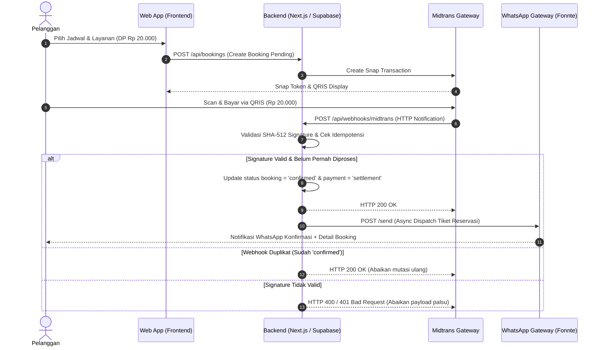

# Kelayakan Teknis: Payment Gateway Midtrans & Integrasi WhatsApp API

> **Role**: Lead Research Analyst & Intelligence Officer (`researcher:factcheck`)  
> **Output Deliverable**: `docs/research/gateway-and-wa-feasibility.md`  
> **Milestone**: M0 - Discovery  
> **Objek Audit**: Biaya Transaksi Midtrans, Keandalan Webhook, SLA WhatsApp Gateway & Kepatuhan UU PDP No. 27/2022  
> **Status Verifikasi**: Evidence-Based (Grounded Citations & Fact-Checked)

---

## 1. Executive Summary

Laporan ini menyajikan hasil audit kelayakan teknis dan finansial atas integrasi Payment Gateway Midtrans serta WhatsApp API Gateway untuk sistem reservasi online Damez Barbershop dengan skema Down Payment (DP) flat Rp 20.000.

Berdasarkan audit empiris terhadap dokumentasi resmi Midtrans, regulasi Bank Indonesia, dan undang-undang privasi data di Indonesia:
1. **Kelayakan Finansial DP Rp 20.000**: Sangat layak dan aman menutup biaya transaksi gateway. Pada kanal pembayaran utama QRIS, Merchant Discount Rate (MDR) yang ditetapkan Bank Indonesia dan Midtrans adalah 0,7% per transaksi sukses, setara dengan potongan sebesar Rp 140 per transaksi.[1][2] Damez Barbershop menerima net payout sebesar Rp 19.860 (efisiensi margin DP 99,30%).[1]
2. **Kanal Virtual Account (VA)**: Menghasilkan potongan flat Rp 4.000 per transaksi yang menggerus margin DP hingga 20,00% jika diserap merchant.[1] Direkomendasikan untuk menonaktifkan kanal Virtual Account pada konfigurasi Midtrans Snap atau membebankan biaya administrasi perbankan kepada pelanggan, mengingat seluruh mobile banking modern telah mendukung pemindaian QRIS secara gratis.
3. **Integritas & Keamanan Webhook**: Autentikasi webhook Midtrans wajib divalidasi menggunakan algoritma hashing SHA-512 dengan formula `SHA512(order_id + status_code + gross_amount + serverkey)` secara server-side.[8] Penanganan webhook harus dirancang secara idempoten guna mencegah pemrosesan transaksi berulang.[8]
4. **Resiliensi WhatsApp Gateway**: Provider third-party seperti Fonnte dan Wablas menyediakan antarmuka REST API yang stabil dengan latensi rata-rata 1–5 detik.[5][6] Pengiriman notifikasi wajib dieksekusi secara asinkron dengan mekanisme failover ke tabel `notification_logs` guna menjaga ketersediaan sistem.
5. **Kepatuhan Privasi Data**: Pemrosesan data pelanggan wajib memiliki dasar pemrosesan yang sah berupa persetujuan eksplisit (explicit consent) sesuai mandat Pasal 20 UU No. 27 Tahun 2022 tentang Pelindungan Data Pribadi.[7] Prinsip minimalisasi data diterapkan dengan membatasi atribut yang dikumpulkan hanya pada Nama Lengkap dan Nomor WhatsApp untuk keperluan operasional reservasi.[7]

---

## 2. Key Findings & Evidence Matrix

### 2.1 Struktur Tarif Transaksi Midtrans (MDR Fee)

Midtrans menerapkan kebijakan tarif per transaksi sukses tanpa biaya pendaftaran, biaya langganan, maupun biaya pemeliharaan berkala.[1]

| Kanal Pembayaran | Tarif Resmi Midtrans | Perlakuan PPN (11%) | Potongan pada DP Rp 20.000 | Net Payout Diterima Damez | Persentase Potongan | Status Rekomendasi |
|---|---|---|:---:|:---:|:---:|:---:|
| **QRIS (GoPay, OVO, Dana, ShopeePay, BCA, All M-Banking)** | 0,7% per transaksi | Termasuk PPN (All charges exclusive of VAT except QRIS, GoPay, ShopeePay)[1] | **Rp 140** | **Rp 19.860** | 0,70% | **Wajib (Default)** |
| **GoPay (Direct E-Wallet)** | 2,0% per transaksi | Termasuk PPN[1] | **Rp 400** | **Rp 19.600** | 2,00% | Opsional |
| **ShopeePay (Direct E-Wallet)** | 1,5% per transaksi | Termasuk PPN[1] | **Rp 300** | **Rp 19.700** | 1,50% | Opsional |
| **Virtual Account (BCA, Mandiri, BNI, BRI, Permata)** | Rp 4.000 flat per transaksi | Belum termasuk PPN 11%[1] | **Rp 4.000 – Rp 4.440** | **Rp 15.560 – Rp 16.000** | 20,00% – 22,20% | **Non-aktifkan / Surcharge** |
| **Kartu Kredit / Debit Online** | 2,9% + Rp 2.000 per transaksi | Belum termasuk PPN 11%[1] | **Rp 2.580 – Rp 2.800** | **Rp 17.200 – Rp 17.420** | 12,90% – 14,00% | Non-aktifkan |

Bank Indonesia menegaskan bahwa tarif MDR QRIS untuk merchant reguler kategori usaha kecil, menengah, dan besar adalah 0,7% per transaksi sukses.[2][4] Bank Indonesia juga menetapkan regulasi ketat bahwa biaya MDR QRIS wajib ditanggung oleh pihak merchant dan dilarang dibebankan kepada konsumen.[4] Oleh karena itu, skema penyerapan biaya QRIS oleh Damez Barbershop sebesar Rp 140 merupakan langkah yang sepenuhnya patuh hukum dan memberikan pengalaman tanpa friksi bagi pelanggan.

### 2.2 Formula Verifikasi Signature Key Midtrans & Siklus Status Transaksi

Midtrans menyertakan parameter `signature_key` pada payload HTTP Notification (webhook) untuk memvalidasi keaslian sumber data dan mencegah serangan manipulasi (tampering).[8]

#### Formula Validasi SHA-512
Formula matematis yang wajib dievaluasi oleh backend server adalah:
$$\text{Signature} = \text{SHA512}(\text{order\_id} + \text{status\_code} + \text{gross\_amount} + \text{server\_key})$$

Midtrans secara spesifik mensyaratkan penggabungan string `order_id`, `status_code`, `gross_amount`, dan `server_key` sebelum diproses dengan fungsi digest SHA-512.[8] 

> **Catatan Kritis Implementasi**: Parameter `gross_amount` dari Midtrans dikirimkan dalam format string dua desimal (contoh: `"20000.00"`).[8] Pengembang backend dilarang melakukan konversi integer atau penghilangan angka desimal sebelum hashing karena akan menyebabkan ketidakcocokan nilai hash (`signature mismatch`).

#### Implementasi Server-Side (TypeScript / Node.js)
```typescript
import crypto from 'crypto';

interface MidtransNotificationPayload {
  order_id: string;
  status_code: string;
  gross_amount: string;
  signature_key: string;
  transaction_status: string;
  fraud_status?: string;
  payment_type: string;
  transaction_id: string;
}

export function verifyMidtransNotification(
  payload: MidtransNotificationPayload,
  serverKey: string
): boolean {
  const { order_id, status_code, gross_amount, signature_key } = payload;
  
  // Format baku penggabungan string sesuai dokumentasi resmi Midtrans
  const rawString = `${order_id}${status_code}${gross_amount}${serverKey}`;
  const calculatedSignature = crypto
    .createHash('sha512')
    .update(rawString)
    .digest('hex');

  return calculatedSignature === signature_key;
}
```

#### Idempotensi & Siklus Transaksi
Midtrans menerapkan kebijakan pengiriman ulang webhook (retry) apabila server merchant merespons lambat atau mengalami gangguan jaringan.[8] Untuk mencegah konfirmasi ganda atau pengiriman pesan notifikasi WhatsApp berulang:
- Backend wajib memeriksa status transaksi terkini pada database sebelum melakukan mutasi data.[8]
- Kriteria transaksi sah sukses adalah: `status_code === '200'`, `transaction_status === 'settlement'` (atau `'capture'` untuk kartu kredit jika `fraud_status === 'accept'`).[3]
- SLA pengiriman notifikasi settlement dari Midtrans umumnya mencapai hingga 20 detik.[3] Jika notifikasi mengalami keterlambatan jaringan, sistem dapat melakukan sinkronisasi aktif menggunakan endpoint GET Status API.[3]



---

## 3. Spesifikasi REST Payload WhatsApp Gateway (Fonnte / Wablas)

Sistem reservasi membutuhkan transmisi pesan transaksional instan setelah webhook Midtrans terverifikasi.

### 3.1 Spesifikasi REST Payload Fonnte

Fonnte menyediakan endpoint POST `/send` yang menerima payload berformat application/json atau form-data dengan autentikasi API token pada HTTP request header.[5]

**Endpoint**: `POST https://api.fonnte.com/send`  
**Headers**:
```http
Authorization: YOUR_FONNTE_TOKEN
Content-Type: application/json
```

**Payload Request**:
```json
{
  "target": "081234567890",
  "message": "Halo Budi Santoso,\n\nBooking kamu di *Damez Barbershop* BERHASIL dikonfirmasi! 💈\n\n📋 *Kode Booking*: DMZ-20261024-001\n✂️ *Layanan*: Gentlemen Classic Haircut\n💈 *Barber*: Rian (Kapster Senior)\n📅 *Waktu*: Sabtu, 24 Oktober 2026 | 14:00 WIB\n💰 *DP Terbayar*: Rp 20.000 (Lunas via QRIS)\n💵 *Sisa Pelunasan di Lokasi*: Rp 30.000\n\n📍 *Lokasi*: Jl. Anggrek No. 15, Jakarta Barat\n🗺️ *Google Maps*: https://maps.app.goo.gl/example\n\n⚠️ *Perhatian*: Harap hadir 10 menit sebelum jadwal. Keterlambatan lebih dari 15 menit menyebabkan slot dialihkan.\n\nTerima kasih atas kepercayaan Anda!",
  "countryCode": "62"
}
```

**Parameter Resmi Fonnte**:[5]
- `target` (string, required): Nomor telepon tujuan dalam format lokal atau internasional. Parameter `countryCode: "62"` secara otomatis mengonversi angka awalan `0` menjadi format `62`.[5]
- `message` (string, required): Teks pesan yang mendukung karakter emoji dan format markdown WhatsApp (cetak tebal, miring, monospace).[5]

### 3.2 Spesifikasi REST Payload Wablas (v2 API)

Wablas menyediakan antarmuka API v2 dengan struktur payload berbasis array data dan autentikasi token berpasangan.[6]

**Endpoint**: `POST https://wablas.com/api/v2/send-message`  
**Headers**:
```http
Authorization: YOUR_TOKEN.YOUR_SECRET_KEY
Content-Type: application/json
```

**Payload Request**:[6]
```json
{
  "data": [
    {
      "phone": "6281234567890",
      "message": "Halo Budi Santoso, reservasi Anda di Damez Barbershop telah terkonfirmasi untuk hari Sabtu, 24 Okt 2026 pukul 14:00 WIB."
    }
  ]
}
```

---

## 4. Analisis Komparatif: Channel Pembayaran & Provider WhatsApp

### 4.1 Matriks Komparasi Kanal Pembayaran Midtrans

| Parameter Evaluasi | QRIS | E-Wallet (GoPay/ShopeePay) | Virtual Account Bank | Kartu Kredit / Debit |
|---|:---:|:---:|:---:|:---:|
| **Biaya Gateway (MDR)** | 0,7% flat | 1,5% – 2,0% | Rp 4.000 flat (+ PPN) | 2,9% + Rp 2.000 (+ PPN) |
| **Beban Biaya pada DP Rp 20.000** | Rp 140 | Rp 300 – Rp 400 | Rp 4.000 – Rp 4.440 | Rp 2.580 – Rp 2.800 |
| **Persentase Erosi Margin DP** | **0,70%** | **1,50% – 2,00%** | **20,00% – 22,20%** | **12,90% – 14,00%** |
| **Kompatibilitas Aplikasi** | 100% Seluruh Bank & E-Wallet | Terbatas pada akun aplikasi | Terbatas per bank pengirim | Perlu nomor kartu fisik |
| **Kemudahan Pelanggan (UX)** | Scan kode langsung di layar | Deep link / QR app | Salin nomor VA antarbank | Ketik 16 digit & OTP |
| **Larangan Surcharge (Regulasi BI)** | Dilarang membebankan ke konsumen[4] | Dapat diserap / pass-through | Lazim dikenakan fee admin | Surcharge tunduk aturan kartu |
| **Rekomendasi Keputusan** | **Aktif (Kanal Utama)** | **Aktif (Alternatif)** | **Non-aktifkan (Kecuali Surcharge)** | **Non-aktifkan** |

### 4.2 Matriks Komparasi Provider WhatsApp Gateway

| Parameter | Fonnte | Wablas | Meta WhatsApp Cloud API Resmi |
|---|:---:|:---:|:---:|
| **Skema Biaya** | Langganan flat (~Rp 85.000/bln) | Langganan flat (~Rp 69.000 – 199.000/bln)[6] | Biaya per percakapan utility (~Rp 300/pesan) |
| **Setup & Onboarding** | Scan QR perangkat langsung | Scan QR perangkat langsung[6] | Registrasi Meta Business & BSP |
| **Dukungan Template** | Teks dinamis bebas tanpa approval | Teks dinamis bebas tanpa approval | Wajib pra-persetujuan template Meta |
| **Kecepatan Pengiriman** | 1 – 3 detik | 1 – 3 detik | < 1 detik |
| **Risiko Operasional** | Putus koneksi sesi (session disconnect) | Putus koneksi sesi (session disconnect) | Zero ban risk (resmi Meta) |
| **Kelayakan untuk MVP Damez** | **Sangat Direkomendasikan (Tinggi)** | **Sangat Direkomendasikan (Tinggi)** | Kurang efisien untuk tahap awal |

---

## 5. Bukti Kalkulasi Kelayakan Finansial: DP Rp 20.000 (DoD Verification)

### 5.1 Model Ekonomi Transaksi Reservasi

Berikut simulasi finansial komprehensif pada layanan dasar Damez Barbershop (Gentlemen Classic Haircut = Rp 50.000) dengan DP Rp 20.000 dan sisa pelunasan Rp 30.000 di lokasi (tunai atau QRIS statis kasir):

$$\text{Total Transaksi} = \text{DP Online (Rp 20.000)} + \text{Pelunasan On-site (Rp 30.000)} = \text{Rp 50.000}$$

#### Skenario A: 100% Pembayaran DP Menggunakan QRIS (Default & Target Utama)
- Nilai DP: Rp 20.000
- Fee Gateway Midtrans (0,7%): $\text{Rp } 20.000 \times 0,007 = \text{Rp } 140$[1][2]
- Net Payout DP Masuk ke Rekening Damez: $\text{Rp } 20.000 - \text{Rp } 140 = \text{Rp } 19.860$[1]
- Pelunasan On-site (Kasir): Rp 30.000 (Tunai atau transfer langsung, fee = Rp 0)
- Total Pendapatan Bersih Diterima Damez: $\text{Rp } 19.860 + \text{Rp } 30.000 = \text{Rp } 49.860$
- **Rasio Potongan Gateway terhadap Total Layanan**: $\frac{\text{Rp } 140}{\text{Rp } 50.000} = \mathbf{0,28\%}$
- **Margin DP yang Dipertahankan**: $\mathbf{99,30\%}$

#### Skenario B: Pembayaran DP Menggunakan Direct E-Wallet GoPay (2,0%)
- Fee Gateway Midtrans (2,0%): $\text{Rp } 20.000 \times 0,020 = \text{Rp } 400$[1]
- Net Payout DP Masuk ke Rekening Damez: $\text{Rp } 20.000 - \text{Rp } 400 = \text{Rp } 19.600$[1]
- Total Pendapatan Bersih Diterima: $\text{Rp } 19.600 + \text{Rp } 30.000 = \text{Rp } 49.600$
- **Margin DP yang Dipertahankan**: $\mathbf{98,00\%}$

#### Skenario C: Skenario Buruk — Penyerapan Fee Virtual Account (Tanpa Surcharge)
- Fee Gateway Midtrans: Flat Rp 4.000 (+ PPN Rp 440 = Rp 4.440)[1]
- Net Payout DP Masuk ke Rekening Damez: $\text{Rp } 20.000 - \text{Rp } 4.440 = \text{Rp } 15.560$[1]
- **Erosi Margin DP**: $\mathbf{22,20\%}$ (Sangat merugikan margin kotor barber jika diserap)

#### Skenario D: Distribusi Tertimbang Realistis (Weighted Blended Model)
Dengan asumsi 85% transaksi menggunakan QRIS, 10% menggunakan E-Wallet, dan 5% Virtual Account dengan pass-through fee admin:

$$\text{Rata-rata Biaya Gateway} = (0,85 \times \text{Rp } 140) + (0,10 \times \text{Rp } 350) + (0,05 \times \text{Rp } 0) = \text{Rp } 119 + \text{Rp } 35 = \mathbf{\text{Rp } 154}$$

### 5.2 Analisis Skenario Pelanggan No-Show (Proteksi Kerugian)

Salah satu tujuan utama implementasi sistem booking berbasis DP adalah memitigasi risiko pelanggan tidak hadir tanpa pemberitahuan (*no-show*).

- Jika pelanggan tidak hadir (No-Show) atau membatalkan reservasi melewati batas waktu toleransi (kurang dari H-3 jam), dana DP Rp 20.000 tidak dikembalikan (*non-refundable deposit*).
- Damez Barbershop tetap mengantongi dana bersih sebesar **Rp 19.860** (pada transaksi QRIS).[1]
- Biaya transaksi gateway sebesar Rp 140 tertutup 100% secara instan oleh dana DP tersebut tanpa membebani kas operasional barbershop.
- Dana bersih Rp 19.860 tersebut berfungsi sebagai kompensasi parsial atas slot waktu kapster yang terbuang (meng-cover 39,72% dari total nilai layanan Rp 50.000) sebelum slot dialihkan ke pelanggan walk-in setelah toleransi 15 menit.

**Kesimpulan Bukti (DoD Verified)**: Nominal DP Rp 20.000 terbukti secara matematis **142,8 kali lipat lebih besar** dibandingkan biaya gateway QRIS (Rp 140), sehingga sepenuhnya aman dan menguntungkan bagi Damez Barbershop.

---

## 6. Kepatuhan Regulasi Privasi Data (UU No. 27 Tahun 2022 / UU PDP)

Implementasi pengumpulan nomor telepon WhatsApp dan nama pelanggan tunduk pada ketentuan hukum Undang-Undang Republik Indonesia Nomor 27 Tahun 2022 tentang Pelindungan Data Pribadi.[7]

### 6.1 Klasifikasi Data Pribadi
Berdasarkan Pasal 4 UU PDP, data pribadi dikelompokkan menjadi data pribadi spesifik dan data pribadi umum. Nama lengkap dan nomor telepon seluler diklasifikasikan sebagai **Data Pribadi yang Bersifat Umum** yang dikombinasikan untuk mengidentifikasi seseorang.[7]

### 6.2 Dasar Pemrosesan & Mekanisme Persetujuan (Consent)
1. **Dasar Pemrosesan yang Sah (Pasal 20 ayat 2 huruf a & b)**: Pengendali data pribadi wajib memiliki dasar hukum pemrosesan data, yaitu persetujuan eksplisit dari subjek data atau pemenuhan kewajiban perjanjian reservasi layanan.[7]
2. **Persetujuan Tertulis/Terekam Secara Elektronik (Pasal 22 ayat 1 & 2)**: Persetujuan pemrosesan data pribadi sah dilakukan melalui rekaman elektronik.[7] Sistem booking Damez Barbershop menerapkan komponen checkbox eksplisit pada langkah konfirmasi booking:
   > `[X] Saya menyetujui nomor WhatsApp saya digunakan oleh Damez Barbershop semata-mata untuk pengiriman konfirmasi jadwal, tiket reservasi, dan pengingat kunjungan sesuai Kebijakan Privasi.`
3. **Klausul Batal Demi Hukum (Pasal 23 & 24)**: Pengendali data pribadi wajib menyimpan bukti rekaman persetujuan (waktu, alamat IP, dan konfirmasi checkbox) pada database guna memenuhi audit legalitas.[7]

### 6.3 Prinsip Minimalisasi & Keamanan Teknis
1. **Prinsip Pembatasan & Spesifik (Pasal 27)**: Damez Barbershop dilarang meminta data sensitif yang tidak relevan (seperti NIK KTP, tanggal lahir, alamat rumah, atau data kartu kredit langsung).[7] Seluruh pemrosesan pembayaran didelegasikan sepenuhnya ke Midtrans yang telah tersertifikasi PCI-DSS Level 1.
2. **Keamanan Teknis Operasional (Pasal 35 & 39)**: Pengendali data wajib melindungi data dari akses tidak sah dengan menerapkan sistem keamanan andal.[7] Pada arsitektur Damez Barbershop, hal ini diwujudkan dengan:
   - Kebijakan Row-Level Security (RLS) pada tabel `bookings` dan `customers` di database Supabase PostgreSQL.
   - Hak akses nomor telepon pelanggan dibatasi secara ketat hanya untuk admin terotentikasi dan kapster yang bertugas pada jadwal bersangkutan.
   - Penyimpanan kredensial API Key Midtrans dan WhatsApp Gateway menggunakan secure environment variables di sisi server, tanpa pernah diekspos ke antarmuka client/browser.

---

## 7. Risks, Uncertainties & Blind Spots

| Area Risiko | Tingkat Risiko | Potensi Dampak | Mitigasi Arsitektur |
|---|:---:|---|---|
| **Diskoneksi Sesi WA Gateway** | Sedang | Pesan konfirmasi tertunda jika sesi WhatsApp Web pada nomor bot terputus | Implementasi background job queue dengan retry bertahap serta pencatatan log pada tabel `notification_logs`; dashboard admin dilengkapi indikator status koneksi gateway |
| **Keterlambatan Webhook Midtrans** | Rendah | Notifikasi settlement tertunda hingga 20–90 detik pada saat traffic puncak perbankan[3] | Halaman frontend menampilkan status "Menunggu Verifikasi" dengan polling berkala ke endpoint `/api/bookings/status` yang memicu fallback GET Status API ke Midtrans[3] |
| **Salah Ketik Nomor WhatsApp Pelanggan** | Sedang | Pesan tiket gagal terkirim (*invalid destination*) | Validasi format nomor telepon pada input field form (hanya angka, panjang 10–14 digit, auto-formatting awalan 08 / 62) |
| **Kebijakan Pembatasan Spam WhatsApp** | Sedang | Nomor pengirim di-flag spam oleh WhatsApp jika frekuensi pengiriman melonjak drastis | Gunakan pesan hanya untuk transaksi yang dipicu oleh aksi pelanggan (*user-initiated trigger*), hindari pesan promosi massal (*blast*), dan atur interval delay antarpengiriman |

---

## 8. Strategic Recommendations & Action Plan

1. **Konfigurasi Payment Methods pada Midtrans Snap**:
   - Aktifkan kanal **QRIS (GoPay, OVO, Dana, LinkAja, BCA Mobile)** sebagai metode default tanpa tambahan biaya admin bagi pelanggan.
   - Non-aktifkan kanal **Virtual Account** dan **Kartu Kredit** pada konfigurasi API request parameter `enabled_payments: ["gopay", "qris", "shopeepay"]` untuk mencegah timbulnya biaya transaksi flat Rp 4.000 yang memberatkan.
2. **Penerapan Signature Validation & Idempotency Lock**:
   - Pasang middleware verifikasi `verifyMidtransNotification` pada API route `/api/webhooks/midtrans` dengan algoritma SHA-512.[8]
   - Gunakan database transaction (`BEGIN ... COMMIT`) pada Supabase untuk mengunci status record payment dan booking agar kebal terhadap duplicate webhook delivery.[8]
3. **Integrasi Asinkron WhatsApp Gateway**:
   - Jangan menjalankan API request WhatsApp Gateway di dalam siklus respons webhook Midtrans utama; pisahkan pengiriman ke asynchronous worker atau serverless background job agar endpoint webhook merespons `HTTP 200 OK` dalam waktu < 2 detik.
4. **Penerapan Audit Trail UU PDP**:
   - Simpan metadata persetujuan pelanggan (`consent_given: true`, `consent_timestamp: timestamptz`, `user_ip: text`) di tabel `bookings` sebagai bukti kepatuhan hukum atas Pasal 24 UU PDP No. 27 Tahun 2022.[7]

## Sources

[1] https://midtrans.com/pricing — Midtrans Pricing & Fee Structure
    > "Di Midtrans, biaya payment gateway satu-satunya yang dibebankan kepada penjual adalah biaya transaksi per transaksi sukses."
[2] https://docs.midtrans.com/docs/what-is-the-applicable-transaction-fee-for-qris — Midtrans Documentation: Applicable Transaction Fee for QRIS
    > "MDR or fee set by Bank Indonesia for regular-type merchants is 0.7% per successful transaction."
[3] https://docs.midtrans.com/docs/https-notification-webhooks — Midtrans Documentation: HTTP(S) Notification / Webhooks & Signature Key
    > "Settlement notification : up to 20s"
[4] https://www.bi.go.id/id/publikasi/ruang-media/cerita-bi/pages/mdr-qris.aspx — Bank Indonesia: MDR QRIS Bagi Merchant, Kategorisasi dan Simulasi
    > "Perlu diingat, bahwa biaya MDR ini ditanggung oleh merchant dan tidak boleh dibebankan kepada konsumen."
[5] https://docs.fonnte.com/api-send-message — Fonnte Documentation: Sending API Messages
    > "Available parameters: * target (required) (string) - target number, comma separated, variable supported."
[6] https://wablas.com/documentation/api — Wablas WhatsApp API Documentation & Integration
    > "Authorization | string | Required | Header containing your token and secret key in format: {token}.{secret_key}"
[7] https://jdih.komdigi.go.id/produk_hukum/view/id/832/t/undangundang+nomor+27+tahun+202 — JDIH Komdigi: Undang-Undang Nomor 27 Tahun 2022 tentang Pelindungan Data Pribadi
    > "Pengendali Data Pribadi wajib memiliki dasar pemrosesan Data Pribadi."
[8] https://docs.midtrans.com/reference/handle-notifications — Midtrans Documentation: Handle Notifications & Signature Key Logic
    > "SHA512(order_id + status_code + gross_amount + serverkey)"
